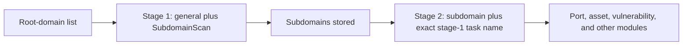

# ScopeSentry MCP guide

This skill is for users of an **already deployed ScopeSentry instance**. It connects Cursor, or another MCP client, to the platform without requiring a local source checkout.

## 1. Preparation

### 1.1 Confirm service access

- Default web interface: `http://<host>`
- MCP endpoint: `http://<host>/mcp`. If a reverse proxy or frontend proxy is present, use its actual `/mcp` address.

### 1.2 Create an API key

1. Sign in to the ScopeSentry web interface.
2. Open the **API Key** management page and create a key, or ask an administrator to create one through the appropriate interface.
3. Save the returned `ssk_...` value. It is **shown only once**.

### 1.3 Configure Cursor MCP

In Cursor, open Settings, then MCP, then add a server:

```json
{
  "mcpServers": {
    "scopesentry": {
      "url": "http://<your-host>:8082/mcp",
      "headers": {
        "X-API-Key": "ssk_your-key"
      }
    }
  }
}
```

`Authorization: Bearer ssk_your-key` is also supported.

After configuration, restart MCP or reload Cursor and confirm tools such as `list_projects` and `list_assets` appear.

---

## 2. Tool overview

| Tool | Purpose |
|---|---|
| `list_projects` | Project tree grouped by tag, including project IDs |
| `list_projects_data` | Paginated project list with name search |
| `get_project` | Project details |
| `create_project` | Create a project |
| `list_tasks` | Scan-task list |
| `get_task` | Task details |
| `list_scan_templates` | Scan-template list |
| `get_scan_template` | Template details |
| `list_plugin_modules` | Scan-pipeline module names |
| `list_plugins` | Available plugins, including hashes and default parameters |
| `create_scan_template` | Create a scan template |
| `create_scan_task` | Create a scan task |
| `list_assets` | Query paginated assets of different types |
| `count_assets` | Count assets through `/api/assets/common/total` |
| `get_asset_detail` | Asset or vulnerability details |
| `add_asset_tag` | Add a tag to an asset |
| `list_nodes` | Scan-node list |

Use the MCP tool description and schema as the authority for parameters. `list_assets` and `count_assets` share the same `search` and `filter` syntax; read the `list_assets` description before constructing an asset query.

When only the total is needed, call `count_assets`, which corresponds to the web UI's pagination-total endpoint. Do not repeatedly page through `list_assets` just to count records.

---

## 3. Common workflows

### 3.1 Query assets by project

When the user or context already identifies a project, include `filter.project` to reduce response size and avoid expensive cross-project queries. Do not require a project filter when no project context exists.

1. Call `list_projects` or `list_projects_data` to obtain the target project's **ObjectID**, returned as `id` or `children[].value`.
2. Pass that ID in `list_assets.filter.project`. Use the ID, not a project display name.

```json
{
  "asset_type": "asset",
  "pageIndex": 1,
  "pageSize": 20,
  "search": "domain=^example.com",
  "filter": {
    "project": ["<project-ObjectID>"]
  }
}
```

### 3.2 Create a scan task

1. Call `list_nodes` to obtain online node names.
2. Call `list_scan_templates`, or `create_scan_template`, to obtain a template **ObjectID**.
3. Call `create_scan_task`. `name` and `node` are required. `template` must contain the template ID, not its display name.

#### Target sources

These `targetSource` values match the web interface:

| `targetSource` | Meaning | Required parameters |
|---|---|---|
| `general` | Directly supplied targets | `target` |
| `project` | Targets read from projects | `project`, an array of project ObjectIDs |
| `asset` | Search the web-asset collection | `search`; optionally `project`, `filter`, and `targetNumber` |
| `RootDomain` | Search the root-domain collection | `search`; optionally `project`, `filter`, and `targetNumber` |
| `subdomain` | Search the subdomain collection | `search`; optionally `project`, `filter`, and `targetNumber` |
| `UrlScan` | Search URL-scan results | `search`; optionally `project`, `filter`, and `targetNumber` |
| A `*Source` value such as `subdomainSource` | Create from selected/searched asset-page records | Use `search` with `targetTp=search`, or `targetIds` with `targetTp=select` |

Direct root-domain scan example:

```json
{
  "name": "example-subdomain-discovery",
  "node": ["node-1"],
  "template": "<template-ObjectID>",
  "targetSource": "general",
  "target": "example.com\nfoo.com",
  "project": ["<project-ObjectID>"]
}
```

Continue from the subdomain collection, filtered by the preceding task name:

```json
{
  "name": "example-ports-and-vulnerabilities",
  "node": ["node-1"],
  "template": "<follow-up-template-ObjectID>",
  "targetSource": "subdomain",
  "search": "task==\"example-subdomain-discovery\"",
  "project": ["<project-ObjectID>"]
}
```

### 3.3 Complete root-domain collection: recommended two-stage workflow

When the input consists of **root domains** and complete information collection is requested, use two scan tasks instead of one full pipeline.

Distributed tasks are assigned per target. If a root domain is one target, the node assigned to it may also process every discovered subdomain through all subsequent modules. This creates uneven load, slower completion, and more failures.

1. **Stage 1: subdomain collection only**
   - `targetSource`: `general`
   - `target`: all root domains, one per line
   - Template: only `SubdomainScan` and `SubdomainSecurity`
   - Poll with `get_task` until complete

2. **Stage 2: follow-up modules**
   - `targetSource`: `subdomain`
   - `search`: `task=="<stage-1-task-name>"`, using an exact task-name match
   - Optionally add `project` to narrow the result set
   - Template: port scan, asset mapping, vulnerability scan, and other follow-up modules; `SubdomainScan` may be omitted
   - Each subdomain becomes an independently distributed target, improving parallelism

The same result can be obtained in the web interface by filtering the Subdomain asset page by task name and choosing the action that creates a task from subdomains.



### 3.4 Create a scan template

1. Call `list_plugin_modules` to obtain module names.
2. Call `list_plugins`, optionally filtered by `module`, to obtain each plugin's `hash` and default `parameter`.
3. Call `create_scan_template` with `modules` mapping module names to arrays of plugin hashes.

---

## 4. Asset queries: `list_assets` and `count_assets`

`count_assets` accepts the same `asset_type`, `search`, and `filter` values as `list_assets`. It returns `{ "total": N }` and corresponds to `/api/assets/common/total`.

```json
{
  "asset_type": "subdomain",
  "search": "task==\"a-task-name\"",
  "filter": {"project": ["<project-ObjectID>"]}
}
```

Performance guidance for both tools:

- When a project is known, use `filter.project` first.
- For indexed fields, prefer exact `==` or a `^` prefix expression. See section 4.3.
- Avoid broad `=` regex searches over large collections.
- Do not invent a project filter when the context does not identify a project.

See section 4.4 for asset types that support `filter.project`.

### 4.1 Asset types

Supported `asset_type` values:

`asset`, `RootDomain`, `subdomain`, `app`, `mp`, `UrlScan`, `SensitiveResult`, `DirScanResult`, `crawler`, `vulnerability`, `PageMonitoring`, `IPAsset`, and `SubdomainTakerResult`.

Examples of aliases: `web` maps to `asset`, `vuln` to `vulnerability`, `ip` to `IPAsset`, and `url` to `UrlScan`.

### 4.2 Parameters

| Parameter | Meaning |
|---|---|
| `pageIndex` / `pageSize` | Pagination, defaulting to 1 / 20 |
| `search` | Search expression described below |
| `filter` | Exact-filter JSON described below |
| `sort` | Only `UrlScan` and `DirScanResult` support sorting by `length` |
| `sid` | For `SensitiveResult` only: sensitive-rule name |

`search` and `filter` may be used together.

### 4.3 `search` expressions

This is a custom DSL, **not SQL**.

| Operator | Meaning | Uses index | Example |
|---|---|---|---|
| `=` | Fuzzy regex match | No | `domain=example` |
| `==` | Exact equality | **Yes** | `port==443` |
| `!=` | Exclusion | — | `port!="80"` |
| `&&` | AND | — | `domain==example.com && port==443` |
| `||` | OR | — | `title=admin || body=login` |

Although fields such as `domain`, `ip`, `port`, and `title` are indexed, only exact `==` and prefix matching with a value beginning with `^`, such as `domain=^example.com`, use an index. `=` becomes a fuzzy regex and can be slow on large collections.

Search fields shared by all asset types are `tag`, `task` (task name), and `rootDomain`.

Do not put `project` in `search`; it is ineffective and can fail when combined with `&&`. Use `filter.project`.

Common type-specific search fields:

| `asset_type` | Fields |
|---|---|
| `asset` | domain, ip, port, service, app, title, statuscode, icon, banner, type, body, header |
| `RootDomain` | domain, icp, company |
| `subdomain` | domain, ip, type, value |
| `app` | name, icp, company, category, description, url, apk |
| `mp` | name, icp, company, category, description, url |
| `UrlScan` | url, input, source, resultId, type |
| `SensitiveResult` | url, sname, body, info, md5 |
| `DirScanResult` | url, statuscode, redirect, length |
| `vulnerability` | url, vulname, matched, request, response, level |
| `crawler` | url, method, body, resultId |
| `PageMonitoring` | url, hash, diff, response |
| `IPAsset` | ip, domain, port, service, webServer, app |
| `SubdomainTakerResult` | domain, value, type, response |

Examples:

- `domain==www.example.com && port==443`: indexed exact equality.
- `domain=^example.com`: indexed prefix match.
- `ip==192.168.1.1`
- `task=="a-task-name"`
- `level==high` for `vulnerability`.
- `statuscode==200` for `DirScanResult`.

Use `=` only when a fuzzy containment search is necessary, for example `title=admin`, and combine it with a project or another narrowing condition when possible.

### 4.4 Exact `filter` values

A filter is a JSON object. Multiple values under the same key are combined with **OR**; different keys are combined with **AND**.

When the project is known and the asset type supports it, prioritize `project`. Do not require one without project context.

| Filter key | Meaning | Value |
|---|---|---|
| `project` | Owning project | **ObjectID** from `list_projects` or `list_projects_data` |
| `task` | Source task | Task `name` from `list_tasks` |
| `port` | Port | For example `"443"` |
| `service` | Service or protocol | For example `"https"` |
| `app` | Application fingerprint | For example `"Nginx"` |
| `icon` | Icon hash | |
| `statuscode` | HTTP status code | Mainly for `asset` |
| `status` | Status | HTTP status for UrlScan/DirScan; handling status for vulnerabilities or sensitive results |
| `level` | Vulnerability severity | critical, high, medium, low, or info |
| `type` | Record/type value | For example subdomain record types A and CNAME |
| `color` | Sensitive-rule color | `SensitiveResult` |
| `sname` | Sensitive-rule name | `SensitiveResult` |
| `tags` | Tags | |

Available filter keys by type:

| `asset_type` | Filter keys |
|---|---|
| `asset` | project, port, service, app, icon, statuscode, type, task, tags |
| `RootDomain` | project, tags |
| `subdomain` | project, type, task, tags |
| `app` / `mp` | project, tags |
| `UrlScan` | status, tags |
| `DirScanResult` | status, tags |
| `SensitiveResult` | status, color, sname, tags |
| `crawler` | project, task, tags |
| `vulnerability` | project, level, status, task, tags |
| `PageMonitoring` / `SubdomainTakerResult` | tags |
| `IPAsset` | project, port, service, app |

Filter example:

```json
{"project": ["<project-ObjectID>"], "port": ["443"]}
```

Combined query example:

```json
{
  "asset_type": "asset",
  "search": "domain=^baidu && port==443",
  "filter": {"project": ["<project-ObjectID>"]},
  "pageIndex": 1,
  "pageSize": 10
}
```

Important details:

- When project context exists and the type supports it, include `filter.project`; otherwise it is optional.
- Never put a project display name in `filter.project`.
- Use `==` for known values and `^` for prefixes; avoid broad `=` searches over large collections.
- For `UrlScan`, filter HTTP status with `filter.status`. For `DirScanResult`, `search` may use `statuscode==200`.
- For a `SensitiveResult` rule name, use `sname=rule-name` in `search`, or use `filter.sname`.

### 4.5 Sorting

Only `UrlScan` and `DirScanResult` support:

```json
{"length": "ascending"}
```

Other asset types ignore `sort` and use their default time-based order.

---

## 5. Scan-template module names

`TargetHandler`, `SubdomainScan`, `SubdomainSecurity`, `PortScanPreparation`, `PortScan`, `PortFingerprint`, `AssetMapping`, `AssetHandle`, `URLScan`, `WebCrawler`, `URLSecurity`, `DirScan`, `VulnerabilityScan`, and `PassiveScan`.

---

## 6. Troubleshooting

| Symptom | Response |
|---|---|
| MCP exposes no tools | Verify the URL, API key, and that ScopeSentry is running |
| 401 / 403 | Recreate or replace the API key |
| Asset query returns nothing | Confirm `filter.project` contains an ObjectID; do not put `project` in `search` |
| Template/task creation fails | `template` must be a template ObjectID; `node` must contain online node names |
| Query is slow or stalls | When a project is known, add `filter.project`; use `==` or `^` on indexed fields instead of broad `=`; reduce `pageSize` |
